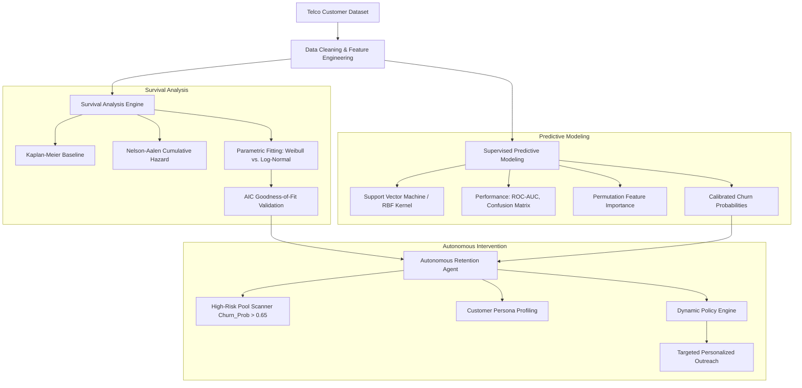

# Autonomous Customer Churn Prediction & Retention Agent
### Multi-Model Comparative Analysis of Time-to-Event Churn Dynamics in Telecom

[](https://www.python.org/downloads/)
[](LICENSE)
[](https://www.kaggle.com/datasets/blastchar/telco-customer-churn)
[](https://colab.research.google.com/drive/1np0nM8u6BcVoXcLyOT_lbxTv_c8AkIOs?usp=sharing)

---

## 📌 Executive Summary

In the telecommunications sector, acquiring a new customer is estimated to be **5 to 25 times more expensive** than retaining an existing one. Despite this asymmetry, conventional churn workflows remain **reactive** and suffer from two critical shortcomings:

1. **Temporal Blindness:** Static binary classification models only answer *"Will this customer churn in 30 days?"* without modeling customer lifecycle longevity, hazard zones, or discrete **"contract cliff"** events.
2. **The Action Gap:** Identifying high-risk customers without context-driven, automated intervention results in wasted retention budgets and generic, unread marketing outreach.

This project delivers a **Hybrid Machine Learning Architecture** that bridges statistical **Survival Analysis (Time-to-Event Modeling)** with **Predictive Classification** and an **Autonomous Agent** to predict churn risk, identify optimal intervention windows, and automatically execute personalized retention strategies.

---

## 🧠 System Architecture



---

## 🔬 Key Components & Methodology

### 1. Survival Analysis (Time-to-Event Dynamics)
- **Non-Parametric Analysis:** Kaplan-Meier survival curves establish empirical baseline retention across customer tenure. Nelson-Aalen estimators quantify cumulative hazard over time.
- **Parametric Fitting & Comparison:** Weibull and Log-Normal distribution models are fitted to test whether churn hazard decreases or exhibits heavy-tailed behavior.
- **Statistical Validation:** Models are evaluated using Akaike Information Criterion (**AIC**) scores to determine optimal parametric fit.
- **Contract Cliff Identification:** Pinpoints tenure milestones where contract expirations trigger elevated churn hazard.

### 2. Supervised Predictive Churn Classifier
- **Model:** Support Vector Classifier (SVC with RBF kernel and probability calibration), alongside comparative baselines (XGBoost, Random Forest, Logistic Regression).
- **Feature Engineering:** Total charges conversion, tenure adjustment ($\epsilon$ smoothing for parametric convergence), tenure-to-contract ratio, and persona tags.
- **Interpretability:** Permutation feature importance analysis isolates key drivers influencing churn decisions (e.g., tenure, monthly charges, contract structure).

### 3. Autonomous Proactive Retention Agent
- **Risk Screening:** Real-time scanning for customers exceeding risk thresholds ($\text{Churn Prob} > 0.65$).
- **Context-Aware Strategy Formulation:**
  - **Urgent Renewal Offer:** Dispatched when contract expiry cliff is imminent ($\le 1$ month).
  - **Discount Bundle:** Applied to high-spending accounts ($\text{MonthlyCharges} > \$90$) sensitive to price changes.
  - **Loyalty Perks:** Rewarded to loyal, lower-spend accounts to maintain engagement.
- **Automated Communication Dispatch:** Dynamically generates persona-aligned retention messaging.

---

## 📂 Repository Structure

```
├── datasets/
│   ├── WA_Fn-UseC_-Telco-Customer-Churn.csv   # Primary Telco churn dataset (IBM / BlastChar)
│   └── Telco_customer_churn.xlsx             # Extended demographic & churn attributes
├── Team 15.case study Implementation.ipynb   # Complete pipeline & agent implementation
├── Team 15.case study Implementation.pdf     # Rendered execution results & figures
├── Team No 15-Case Study Report.docx         # Comprehensive academic case study report
├── requirements.txt                          # Project Python dependencies
├── CONTRIBUTING.md                           # Guidelines for contributions
├── LICENSE                                   # MIT License
└── README.md                                 # Project documentation
```

---

## 🚀 Getting Started

### Prerequisites
- Python 3.10+
- Virtual environment tool (`venv` or `conda`)

### Installation

1. **Clone the repository:**
   ```bash
   git clone <REPO_URL>
   cd <REPO_DIRECTORY>
   ```

2. **Create and activate a virtual environment:**
   ```bash
   python -m venv .venv
   # Windows (PowerShell):
   .venv\Scripts\Activate.ps1
   # Linux / macOS:
   source .venv/bin/activate
   ```

3. **Install dependencies:**
   ```bash
   pip install -r requirements.txt
   ```

4. **Run the Notebook:**
   ```bash
   jupyter notebook "Team 15.case study Implementation.ipynb"
   ```
   *Alternatively, run directly on Google Colab using the badge above.*

---

## 📊 Dataset Reference

- **Source:** IBM Business Analytics community, hosted on [Kaggle: Telco Customer Churn](https://www.kaggle.com/datasets/blastchar/telco-customer-churn)
- **Sample Size:** 7,043 customer records
- **Feature Dimensions:** 21 attributes spanning:
  - **Demographics:** Gender, SeniorCitizen, Partner, Dependents
  - **Subscribed Services:** PhoneService, MultipleLines, InternetService (DSL/Fiber Optic), OnlineSecurity, TechSupport, Streaming
  - **Account Metadata:** Contract type (Month-to-month, One year, Two year), PaperlessBilling, PaymentMethod, MonthlyCharges, TotalCharges
  - **Target:** `Churn` (Yes / No)

---

## 👥 Authors & Academic Attribution

**Course:** 22AIE213 – Machine Learning (4th Semester)  
**Institution:** Amrita Vishwa Vidyapeetham  
**Instructor:** Dr. G Bharathi Mohan  

### Team 15:
- **Lakshmi Kanthan S** (CH.SC.U4AIE24041)
- **Linkesh G** (CH.SC.U4AIE24042)
- **Suryaa N** (CH.SC.U4AIE24073)
- **V S Naren Kumar** (CH.SC.U4AIE24077)
- **Lishanth SS** (CH.SC.U4AIE24083)

---

## 📄 License

This project is licensed under the [MIT License](LICENSE).
